&nbsp;

&nbsp;

&nbsp;

Now: architecting the future with untethered curiosity.

Origin: 21 years old, building toward the future of AI and robotics.

Mandate: shipping scalable B2B and B2C products and complete digital ecosystems at Pixra Global.

Core project: QuduHub, a general-purpose AI workspace that brings conversational AI, deep research and creation into one place.

Engineering: going deep on C++ to build high-performance, resilient systems and next-generation search engines.

Endgame: moving into deep-tech research to build climate-resilient, intelligent humanoids that assist people.

<b>Languages</b>

<b>Frameworks and platforms</b>

<b>Infrastructure and deployment</b>

<!-- 01. LIVE CONTRIBUTION AREA GRAPH & PROFILE TELEMETRY (REPLACES BROKEN ACTIVITY GRAPH) -->
<b>Live Contribution Velocity & System Overview</b>

<!-- 02. ALL-TIME COMMITS & STREAK CONSISTENCY -->
<b>All-Time Commit Metrics & Execution Streak</b>

<!-- 03. DEEP COMMIT DISTRIBUTION & VELOCITY TRIO -->
<b>Commit Language Share, Repo Density & Throughput</b>

<!-- 04. CRIMSON PRODUCTIVE COMMIT HOURS (UTC +5:30) -->
<b>Peak Commit Hours & Productive Rhythm (UTC +5:30)</b>

&nbsp;

&nbsp;

<!-- COMMIT TELEMETRY STATUS BAR -->

&nbsp;

&nbsp;

<!-- LAYER A: 365-DAY CRIMSON HEATMAP MATRIX -->
<b>365-Day Crimson Contribution Heatmap</b>

<!-- LAYER B: ANIMATED PAC-MAN COMMIT EXECUTION GRAPH -->
<b>Autonomous Commit Execution Grid</b>

<picture>
<source media="(prefers-color-scheme: dark)" srcset="https://raw.githubusercontent.com/Radhebharadwaj/Radhebharadwaj/output/pacman-contribution-graph-dark.svg">
<source media="(prefers-color-scheme: light)" srcset="https://raw.githubusercontent.com/Radhebharadwaj/Radhebharadwaj/output/pacman-contribution-graph.svg">

</picture>

Designed and built by Radhe Bharadwaj

