<!-- ═══════════════════════════════════════════════════════════════════════════
HERO HEADER & NEURAL IDENTITY
═══════════════════════════════════════════════════════════════════════════ -->

<!-- LIVE STATUS & TELEMETRY BADGE BAR -->

&nbsp;

&nbsp;

&nbsp;

<!-- 🔴 PREMIUM CRIMSON LASER SEPARATOR LINE -->

<!-- ═══════════════════════════════════════════════════════════════════════════
SECTION 01 // NEURAL PATHWAYS & VISION
═══════════════════════════════════════════════════════════════════════════ -->
<h3 align="center">⟡ &nbsp;<code>01 // NEURAL PATHWAYS &amp; VISION</code>&nbsp; ⟡</h3>

<i>"Architecting the future with untethered curiosity — from high-concurrency C++ engines to intelligent humanoid systems."</i>

@@ SYSTEM ARCHITECTURE & OPERATOR MANIFESTO // RADHEBHARADWAJ @@
!OPERATOR_PROFILE   :: 21-Year-Old Tech Architect | AI Systems & Deep-Tech Robotics
+CURRENT_MANDATE    :: Founder @ Pixra Global — Scaling B2B & B2C Digital Ecosystems
+CORE_FLAGSHIP      :: Orchestrating QuduHub (qudu.in) — General-Purpose AI Workspace
+SYSTEMS_CORE       :: High-Performance C++ Architecture & Next-Gen Search Engines
-THE_ENDGAME        :: Climate-Resilient, Autonomous Intelligent Humanoids for Humanity

<table width="100%">
<tr>
<td width="50%" valign="top">
<h4>🚀 &nbsp;Pixra Global &amp; Ecosystem Design</h4>

Building resilient, hyper-scalable <b>B2B &amp; B2C products</b> and end-to-end digital ecosystems at <a href="https://github.com/pixra"><b>Pixra Global</b></a> — engineered for high availability, clean developer ergonomics, and rapid global deployment.

</td>
<td width="50%" valign="top">
<h4>⚡ &nbsp;QuduHub — AI Workspace</h4>

Orchestrating <a href="https://qudu.in"><b>QuduHub</b></a>, a unified <b>General-Purpose AI Workspace</b> that converges multi-model conversational intelligence, autonomous deep research, and real-time creation into one seamless environment.

</td>
</tr>
<tr>
<td width="50%" valign="top">
<h4>🧠 &nbsp;Low-Level C++ &amp; Search Systems</h4>

Deep-diving into modern <b>C++</b> to architect ultra-low-latency, memory-resilient backend systems, distributed compute pipelines, and next-generation indexing &amp; search engines.

</td>
<td width="50%" valign="top">
<h4>🤖 &nbsp;The Endgame — Intelligent Humanoids</h4>

Transitioning software intelligence into physical embodiment: advancing deep-tech robotics research to build <b>climate-resilient, autonomous humanoids</b> designed to assist humanity in complex environments.

</td>
</tr>
</table>

&nbsp;

&nbsp;

<!-- 🔴 PREMIUM CRIMSON LASER SEPARATOR LINE -->

<!-- ═══════════════════════════════════════════════════════════════════════════
SECTION 02 // CORE TECHNOLOGY ARSENAL
═══════════════════════════════════════════════════════════════════════════ -->
<h3 align="center">⟡ &nbsp;<code>02 // CORE TECHNOLOGY ARSENAL</code>&nbsp; ⟡</h3>

<table width="100%">
<thead>
<tr>
<th width="33%" align="center">⚙️ <code>CORE LANGUAGES</code></th>
<th width="34%" align="center">🧩 <code>ARCHITECTURE &amp; ECOSYSTEMS</code></th>
<th width="33%" align="center">☁️ <code>INFRASTRUCTURE &amp; OPS</code></th>
</tr>
</thead>
<tbody>
<tr>
<td align="center">
 

  
<b>Systems, AI Scripting &amp; Type-Safe Web</b>
</td>
<td align="center">
 

  
<b>Full-Stack Frameworks &amp; Edge Compute</b>
</td>
<td align="center">
 

  
<b>Containerization, Cloud &amp; CI/CD Pipelines</b>
</td>
</tr>
</tbody>
</table>

<!-- 🔴 PREMIUM CRIMSON LASER SEPARATOR LINE -->

<!-- ═══════════════════════════════════════════════════════════════════════════
SECTION 03 // SYSTEM TELEMETRY & PERFORMANCE HUD
═══════════════════════════════════════════════════════════════════════════ -->
<h3 align="center">⟡ &nbsp;<code>03 // SYSTEM TELEMETRY</code>&nbsp; ⟡</h3>

<b><code>CORE METRICS &amp; LANGUAGE DISTRIBUTION</code></b>

<b><code>STREAK &amp; EXECUTION CONSISTENCY</code></b>

<b><code>DYNAMIC ACTIVITY TELEMETRY</code></b>

<b><code>PRODUCTIVE TIME DISTRIBUTION (UTC +05:30)</code></b>

<!-- 🔴 PREMIUM CRIMSON LASER SEPARATOR LINE -->

<!-- ═══════════════════════════════════════════════════════════════════════════
SECTION 04 // ARCHITECTURAL CONTRIBUTIONS
═══════════════════════════════════════════════════════════════════════════ -->
<h3 align="center">⟡ &nbsp;<code>04 // ARCHITECTURAL CONTRIBUTIONS</code>&nbsp; ⟡</h3>

<picture>
<source media="(prefers-color-scheme: dark)" srcset="https://raw.githubusercontent.com/Radhebharadwaj/Radhebharadwaj/output/pacman-contribution-graph-dark.svg" />
<source media="(prefers-color-scheme: light)" srcset="https://raw.githubusercontent.com/Radhebharadwaj/Radhebharadwaj/output/pacman-contribution-graph.svg" />

</picture>

<!-- 🔴 PREMIUM CRIMSON LASER SEPARATOR LINE -->

<!-- ═══════════════════════════════════════════════════════════════════════════
SECTION 05 // ESTABLISH A SECURE CONNECTION
═══════════════════════════════════════════════════════════════════════════ -->
<h3 align="center">⟡ &nbsp;<code>05 // ESTABLISH A SECURE CONNECTION</code>&nbsp; ⟡</h3>

<b>Direct Uplinks for Collaboration, Deep-Tech Ventures &amp; Ecosystem Architecture</b>

&nbsp;

&nbsp;

&nbsp;

<!-- 🔴 PREMIUM CRIMSON-TO-OBSIDIAN WAVING FOOTER -->

